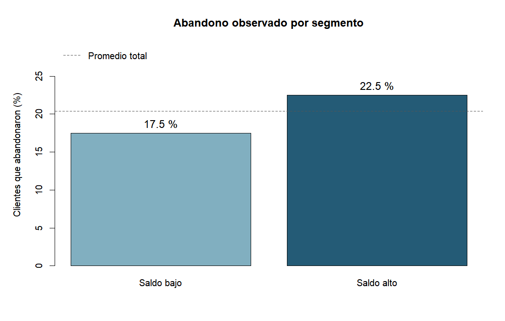

# Segmentación de clientes bancarios y abandono observado

¿Qué grupos de clientes aparecen al combinar saldo, edad, antigüedad, productos y puntaje crediticio? ¿El abandono registrado es igual en esos grupos? Este trabajo individual del módulo de Análisis Predictivo del diplomado de la UPB explora esas preguntas con 10.000 registros y R. La comparación sirve para describir el archivo; no es un modelo que prediga qué cliente abandonará el banco.



## Problema

Un equipo de retención podría usar segmentos para decidir dónde investigar primero. Antes de recomendar una acción, hay que comprobar si los grupos formados por características del cliente se relacionan con el abandono registrado. La segmentación por sí sola no mide ese abandono.

## Datos

El CSV fue entregado por el docente del módulo. Tiene **10.000 filas y 18 columnas**; cada fila representa un cliente. Se desconocen la fuente original, el periodo de recopilación y la moneda de `Balance`. [Diccionario y límites del archivo](data/README.md).

El agrupamiento usa `CreditScore`, `Balance`, `Age`, `Tenure` y `NumOfProducts`. La columna `Exited` (`1` = abandonó, `0` = permaneció) se reserva para describir los grupos después del entrenamiento. Los identificadores, apellidos y demás columnas no participan en el algoritmo.

## Método

1. Revisar dimensiones, valores ausentes, distribuciones y correlaciones de las cinco variables.
2. Estandarizarlas; usar PCA para inspeccionar su estructura y el método del codo como referencia. Se fijan dos grupos para una comparación interpretable; la curva no establece un número óptimo único.
3. Ajustar K-Means con dos grupos y 25 inicializaciones; nombrarlos por su saldo medio.
4. Calcular tamaño, saldo medio, edad, puntaje y tasa de abandono observada por grupo. Comparar de forma exploratoria con agrupamiento jerárquico sobre 1.000 registros.

## Resultados

| Segmento | Clientes | Abandonaron (`Exited = 1`) | Permanecieron (`Exited = 0`) | Saldo medio* | Tasa de abandono |
| --- | ---: | ---: | ---: | ---: | ---: |
| Saldo bajo | 4.196 | 733 | 3.463 | 12.150,12 | 17,47 % |
| Saldo alto | 5.804 | 1.305 | 4.499 | 122.997,42 | 22,48 % |

La tasa se calcula **dentro de cada grupo**: `abandonaron / clientes × 100`. Por ejemplo, `1.305 / 5.804 × 100 = 22,48 %` para saldo alto y `733 / 4.196 × 100 = 17,47 %` para saldo bajo. En total abandonaron **2.038 de 10.000 clientes (20,38 %)**. La diferencia entre las tasas es **5,02 puntos porcentuales**, medida como saldo alto menos saldo bajo.

\* La moneda del saldo no está documentada.

El grupo con mayor saldo presenta una tasa de abandono observada mayor. Es un punto de partida para investigar, no prueba que el saldo provoque abandono ni justifica tratar a cada integrante del grupo como cliente en riesgo. El método jerárquico, aplicado a una muestra, produjo una partición distinta; las etiquetas de los grupos dependen de la técnica elegida.

## Conclusión y límites

Para una decisión de retención, revisaría primero cómo se distribuye `Exited` junto con otras variables del archivo y comprobaría el resultado en otro periodo o conjunto. Con la procedencia y la fecha originales desconocidas, no se puede extrapolar esta diferencia a los clientes actuales de un banco. Este análisis no evalúa capacidad predictiva ni establece causas.

La [evaluación del alcance causal de los datos](docs/alcance_causal.md) registra qué asociaciones se pueden comprobar, qué información falta y cómo se podría diseñar un estudio sobre causas.

## Aprendizajes

Separar la variable de abandono de las variables de agrupamiento permitió distinguir **segmentación** de **validación descriptiva**: una diferencia de saldo no indica por sí misma qué grupo abandonó más. Si repitiera el análisis, contrastaría la estabilidad de los grupos y usaría datos de otro periodo antes de proponer una intervención.

## Habilidades técnicas utilizadas

- **R y preparación de datos:** selección de columnas, revisión de ausentes, correlaciones y estandarización.
- **Análisis no supervisado:** PCA, método del codo, K-Means y contraste exploratorio con clustering jerárquico.
- **Interpretación:** cálculo de tasas por segmento y gráfico que compara los grupos con el promedio total.

## Reproducir

Desde la raíz del repositorio, con **R 4.4.2** o una versión compatible:

```sh
Rscript scripts/analisis_clientes.R
```

El script usa funciones incluidas en R, lee `data/data.csv` y genera `results/resumen_segmentos.csv`, `images/metodo_codo.png` e `images/abandono_por_segmento.png`. Fija la semilla para repetir el agrupamiento.
